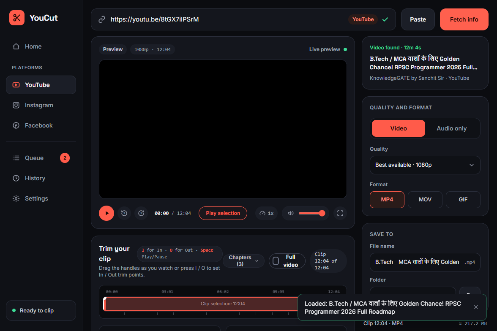

# YouCut v2.0

<div align="center">



**Fast, frame-accurate desktop video & audio clipper for Windows.**  
*Built with Electron 33, TypeScript, React 18, Vite, and Tailwind CSS.*

[](https://www.electronjs.org/)
[](https://react.dev/)
[](https://www.typescriptlang.org/)
[](https://vitejs.dev/)
[](https://tailwindcss.com/)
[](LICENSE)

</div>

---

## 📖 Table of Contents
1. [Overview](#-overview)
2. [Key Features](#-key-features)
3. [Technology Stack](#-technology-stack)
4. [Project Structure](#-project-structure)
5. [Installation & Setup Guide](#-installation--setup-guide)
   - [Prerequisites](#prerequisites)
   - [Step-by-Step Installation](#step-by-step-installation)
   - [Troubleshooting Windows PowerShell](#troubleshooting-windows-powershell)
6. [Available Scripts](#-available-scripts)
7. [Implementation Progress & Roadmap](#-implementation-progress--roadmap)
8. [Maintenance & Documentation Protocol](#-maintenance--documentation-protocol)

---

## 🌟 Overview

**YouCut v2.0** is a high-performance Windows desktop application designed to clip, trim, and download videos and audio from YouTube, Instagram, and Facebook with sub-second responsiveness and frame-accurate precision.

Unlike web-based downloaders that hit paywalls, rate limits, or slow compression queues, YouCut runs standalone local binaries (`yt-dlp`, `ffmpeg`, `ffprobe`) orchestrating downloads with multi-fragment concurrent connections directly to your PC.

### Why YouCut v2.0?
- **Zero Python/Qt in the UI**: Clean, maintainable TypeScript + React frontend in an isolated Electron renderer.
- **Frame-Accurate Cuts**: Automatic keyframe regeneration at cut boundaries for exact trimming.
- **Smart Queue Engine**: Sequential queue management with live JSON stream metrics, pause/resume, and watchdog stalls recovery.
- **Theme Support**: Seamless toggling between a sleek Dark Mode (default) and a crisp, high-contrast Light Mode.
- **Persistent State**: Multi-tab route switching without unmounting; your fetched video, trim points, and playback states are never lost when changing tabs.

---

## ⚡ Key Features

- **Direct URL Fetching & Platform Auto-Routing**: Automatically identifies YouTube, Instagram, and Facebook URLs from the clipboard or manual input.
- **Live Video Preview & Player Controls**:
  - Embedded player with zero lag scrubbing.
  - Variable Playback Speed (0.5x, 0.75x, 1x, 1.25x, 1.5x, 1.75x, 2x).
  - Volume slider and one-click mute toggle.
  - Pro keyboard shortcuts: <kbd>Space</kbd> (Play/Pause), <kbd>I</kbd> (Set In Point), <kbd>O</kbd> (Set Out Point), <kbd>←</kbd> / <kbd>→</kbd> (Seek 5s).
- **Interactive Trimming Controls**:
  - Drag-to-trim timeline track with visual selection highlights.
  - START & END timecode inputs with stepper buttons (`-1s`, `+1s`).
  - One-click quick presets: `First 30s`, `First 60s`, `Middle 50%`, `Last 30s`, `Reset`.
  - YouTube Chapters integration: Jump to any chapter or batch-add all chapters to queue in one click.
- **Ultra-Premium Download Queue**:
  - Instant transition on "Add to queue" directly to the Queue view.
  - Visual video thumbnail preview with duration badge.
  - Format/Quality pills (`MP4`, `1080p`, etc.) and clip range indicators (`✂️ 00:01 → 00:54`).
  - Glowing animated gradient progress bar with live speed (`⚡ 6.4 MB/s`), ETA, and downloaded MBs.
  - Pause, Resume, Cancel, "Show in folder", and "Play" actions.
- **Validation Engine**: Automated post-download verification via `ffprobe` checking file existence, audio/video streams, and duration tolerance.
- **History Log**: Complete historical record of all completed downloads with search and quick reveal in Windows File Explorer.

---

## 🛠 Technology Stack

| Layer | Technology | Details |
| :--- | :--- | :--- |
| **Desktop Runtime** | [Electron 33](https://www.electronjs.org/) | Multi-process desktop container (`contextIsolation: true`, `nodeIntegration: false`) |
| **Frontend Framework** | [React 18](https://react.dev/) + [TypeScript 5](https://www.typescriptlang.org/) | Strictly typed UI components and reactive state |
| **Build & Bundler** | [electron-vite](https://electron-vite.org/) + [Vite 5](https://vitejs.dev/) | HMR in dev, highly optimized SSR & web production bundles |
| **Styling & Design System** | [Tailwind CSS 3](https://tailwindcss.com/) | Semantic CSS design tokens (`tokens.css`) supporting Dark and Light themes |
| **Media Processing** | [yt-dlp](https://github.com/yt-dlp/yt-dlp) | Media extraction, format merging, and section cutting |
| **Video Inspection & Codecs**| [FFmpeg 7](https://ffmpeg.org/) + `ffprobe` | Transcoding, keyframe generation, and stream verification |
| **Testing & Automation** | [Playwright](https://playwright.dev/) + [Vitest](https://vitest.dev/) | Headless browser integration testing & screenshot capture |

---

## 📂 Project Structure

```
YouCut v2.0/
├── docs/                             # Documentation, architecture specs & visual evidence
│   ├── design-inventory/             # Reference design inventory screenshots
│   ├── screenshots/                  # Verified feature screenshots for each phase
│   │   ├── p0-styleguide-...png
│   │   ├── p2/                       # Phase 2 metadata & error states
│   │   └── p3/                       # Phase 3 engine, queue & theme screenshots
│   ├── DESIGN-INVENTORY.md           # Visual design tokens & audit
│   ├── PROGRESS.md                   # Real-time task progress and verification status
│   ├── SPEC.md                       # Complete technical design specification
│   └── SPIKE.md                      # Video preview spike research & architecture decision
│
├── resources/                        # Bundled application resources
│   └── bin/                          # Standalone native binaries for Windows
│       ├── yt-dlp.exe                # Latest yt-dlp executable
│       ├── ffmpeg.exe                # FFmpeg 7.1 essentials build
│       └── ffprobe.exe               # FFprobe 7.1 essentials build
│
├── scripts/                          # Automated development & verification scripts
│   ├── capture-p2-gate-screenshots.mjs # Phase 2 screenshot automation
│   ├── capture-p3-gate-screenshots.mjs # Phase 3 queue, theme & shortcuts capture
│   ├── fetch-binaries.mjs            # Automated downloader for yt-dlp & ffmpeg
│   ├── inventory-design.mjs          # Design audit & reference capture script
│   └── verify-p3-engine.mjs          # Core engine & validation test runner
│
├── src/
│   ├── main/                         # Electron Main Process (Node.js runtime)
│   │   ├── config/                   # Binary paths and environment isolation
│   │   │   └── paths.ts              # getBinaryPath() & YOUCUT_HOME resolution
│   │   ├── download/                 # Download engine & queue management
│   │   │   ├── history.ts            # Persistent history storage (%APPDATA%\YouCut2)
│   │   │   ├── queue.ts              # Sequential queue manager & 90s watchdog
│   │   │   └── validator.ts          # ffprobe output verification
│   │   ├── ipc/                      # IPC handlers for renderer communication
│   │   │   └── index.ts              # Clipboard, dialogs, shell, and metadata IPC
│   │   └── index.ts                  # Main Electron app lifecycle & window configuration
│   │
│   ├── preload/                      # Electron Preload Scripts (Isolated bridge)
│   │   └── index.ts                  # contextBridge exposing window.api methods
│   │
│   └── renderer/                     # Electron Renderer Process (React 18 + Tailwind)
│       └── src/
│           ├── components/           # Reusable UI component library
│           │   ├── AppShell.tsx      # Main layout with tab visibility preservation
│           │   ├── Badge.tsx         # Status pills & FullVideoCheckbox
│           │   ├── Button.tsx        # Styled button variants (primary, secondary, ghost)
│           │   ├── Card.tsx          # Themed surface containers
│           │   ├── ChaptersPopover.tsx # YouTube chapters popover & batch action
│           │   ├── Chip.tsx          # Format chips & platform pills
│           │   ├── Field.tsx         # Inputs and custom dropdown fields
│           │   ├── Icons.tsx         # Lucide SVG icon wrappers
│           │   ├── Sidebar.tsx       # 195px navigation sidebar with active states
│           │   ├── Toast.tsx         # Toast notification container
│           │   ├── UrlBar.tsx        # Top URL input bar with paste & platform check
│           │   └── WrongPlatformBanner.tsx # Platform mismatch warning banner
│           ├── context/              # React Context Providers
│           │   └── NavigationContext.tsx # Routing, active tab, toast queue, status
│           ├── routes/               # Top-level application views
│           │   ├── Home.tsx          # Landing screen with platform shortcuts
│           │   ├── YouTube.tsx       # YouTube clipping, preview, trimming, quality
│           │   ├── Instagram.tsx     # Instagram module shell
│           │   ├── Facebook.tsx      # Facebook module shell
│           │   ├── Queue.tsx         # Real-time sequential download queue
│           │   ├── History.tsx       # Completed clips history & file reveal
│           │   └── Settings.tsx      # Theme switcher, directories, concurrency
│           ├── styles/               # CSS and theme tokens
│           │   ├── globals.css       # Tailwind base styles and resets
│           │   └── tokens.css        # Dark & Light theme CSS custom properties
│           ├── types/                # TypeScript interface declarations
│           │   └── routes.ts         # RouteId definitions
│           ├── utils/                # Utility helper functions
│           │   ├── clipboard.ts      # Native clipboard wrapper
│           │   ├── filename.ts       # Windows safe filename sanitizer
│           │   └── time.ts           # Timecode parsing (secondsToHms, hmsToSeconds)
│           ├── App.tsx               # Root React entry component
│           └── main.tsx              # DOM hydration & React root mount
│
├── electron.vite.config.ts           # Vite configuration for main, preload & renderer
├── package.json                      # Project dependencies and script declarations
├── tailwind.config.js                # Tailwind theme binding with CSS variables
└── tsconfig.json                     # TypeScript compiler root configuration
```

---

## 🚀 Installation & Setup Guide

### Prerequisites
Make sure the following tools are installed on your Windows machine:
1. **Node.js**: `v20.x` or higher (LTS recommended) — [Download Node.js](https://nodejs.org/)
2. **Git**: Installed and available in your system `PATH` — [Download Git](https://git-scm.com/)
3. **Windows OS**: Windows 10 or 11 (64-bit)

---

### Step-by-Step Installation

#### 1. Clone the Repository
Open PowerShell or your preferred terminal and clone the repository:
```bash
git clone https://github.com/Ady1107/YouCut-2.0.git -b dev
cd "YouCut v2.0"
```

#### 2. Install Project Dependencies
Install all required Node.js packages:
```bash
npm install
```
*(On Windows PowerShell, if `npm` gives a script execution error, see the troubleshooting section below or use `npm.cmd install`)*

#### 3. Fetch Native Media Binaries
YouCut requires `yt-dlp.exe`, `ffmpeg.exe`, and `ffprobe.exe` in the `resources/bin/` folder.  
Run the automated downloader script:
```bash
npm run fetch-binaries
```
This script automatically downloads the latest release binaries directly from GitHub and extracts them into `resources/bin/`.

#### 4. Run in Development Mode
Launch the Electron application in hot-reloading development mode:
```bash
npm run dev
```
The app will launch immediately with full Vite Hot Module Replacement (HMR).

#### 5. Build for Production
To typecheck and compile the application for production distribution:
```bash
npm run build
```
Compiled bundles will be generated in the `out/` directory (`out/main`, `out/preload`, `out/renderer`).

---

### ⚠️ Troubleshooting Windows PowerShell

#### Problem: `npm : File ... npm.ps1 cannot be loaded because running scripts is disabled on this system`
This is a standard Windows PowerShell security restriction. You can solve it using any of the following methods:

**Method A (Recommended — Direct Command)**:  
Use `npm.cmd` instead of `npm`:
```powershell
npm.cmd install
npm.cmd run fetch-binaries
npm.cmd run dev
```

**Method B (One-time PowerShell Policy Update)**:  
Enable local script execution for your user account:
```powershell
Set-ExecutionPolicy -Scope CurrentUser -ExecutionPolicy RemoteSigned
```
Then run normal `npm run dev`.

**Method C (Standard Command Prompt)**:  
Open standard Windows `cmd.exe` instead of PowerShell, navigate to the folder, and run:
```cmd
npm run dev
```

---

## 📜 Available Scripts

| Command | Description |
| :--- | :--- |
| `npm run dev` | Starts Electron and Vite in development mode with live HMR |
| `npm run build` | Runs TypeScript typechecking and compiles production bundles |
| `npm run fetch-binaries` | Automated download and extraction of `yt-dlp`, `ffmpeg`, and `ffprobe` |
| `npm run typecheck` | Typechecks both Node (main/preload) and Web (renderer) codebases |
| `npm run format` | Formats the codebase using Prettier |
| `npm run lint` | Runs ESLint across all `.ts`, `.tsx`, `.js` files |
| `npm run test` | Runs unit tests with Vitest |
| `npm run test:e2e` | Runs Playwright end-to-end integration tests |

---

## 📈 Implementation Progress & Roadmap

We follow a strict 6-phase engineering roadmap:

| Phase | Milestone | Status | Key Highlights |
| :---: | :--- | :---: | :--- |
| **Phase 0** | **Scaffolding & Tooling** | ✅ Completed | Electron 33 + Vite + Tailwind, standalone binaries in `resources/bin/`, isolated user data paths. |
| **Phase 1** | **Application Shell & UI** | ✅ Completed | 195px sidebar, navigation router, toast notifications, design system components. |
| **Phase 2** | **YouTube Metadata & Trimming** | ✅ Completed | Real metadata extraction via yt-dlp, interactive timeline, chapters popover, resolution dropdowns. |
| **Phase 3** | **Engine Execution & Queue** | ✅ Completed | Sequential download manager, 90s watchdog timeout, process tree termination, light & dark themes, glowing queue UI, speed & volume controls. |
| **Phase 4** | **Filmstrip & Pro Shortcuts** | 🔄 Next Up | Storyboard thumbnail filmstrip cache, unified TrimModel, extended keyboard shortcut overlays. |
| **Phase 5** | **Multi-Format Exporters** | ⏳ Planned | Remux to MOV, animated GIF converter with palette generation, audio extraction (MP3, M4A, WAV). |
| **Phase 6** | **Instagram & Facebook Modules** | ⏳ Planned | Extraction and section clipping for Instagram Reels and Facebook Watch videos. |

*For detailed item-by-item verification logs and evidence, consult [docs/PROGRESS.md](docs/PROGRESS.md).*

---

## 🔄 Maintenance & Documentation Protocol

To maintain complete synchronicity across development iterations:

1. **Keep `README.md` Updated**: Whenever new architectural components, scripts, or core features are added, update the relevant section of this document.
2. **Keep `docs/PROGRESS.md` Updated**: After completing any milestone or phase, mark its status (`verified (with evidence)`) and log the screenshot or test evidence.
3. **Commit to Branch `dev`**: All active development commits should be pushed to the `dev` branch on GitHub:
   ```bash
   git add .
   git commit -m "feat/fix: <description>"
   git push origin dev
   ```

---

<div align="center">

Crafted with precision for creators, clippers, and editors.  
© 2026 YouCut Team. Released under the MIT License.

</div>
